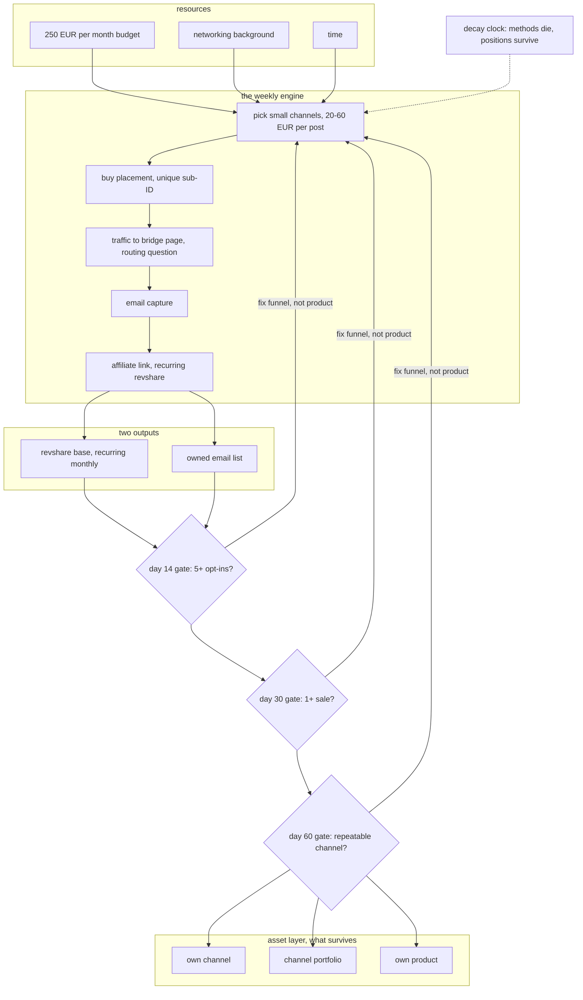

# Big picture

## The system

## How to read it

Top to bottom, one sentence: convert a temporary asymmetry into a permanent
position, and let the gates decide whether you are allowed to.

- **Resources** — the three things actually available.
- **The engine** — a weekly loop. Email capture sits before the affiliate link;
  that ordering is the design.
- **The two outputs** — revshare and the email list are the asset, not the reward.
- **The gates loop backward, not down.** A failed gate means fix the funnel, not
  change the product.
- **The asset layer** — own channel, portfolio, own product.
- **The dotted line** — the decay clock hits tactics; the asset is what you built
  before it arrived.

## Phases

| Phase | When | Income | You own |
|---|---|---|---|
| 0 Setup | done | 0 | nothing |
| 1 Validate | month 1-3 | 0-300 | small email list |
| 2 Repeat | month 3-9 | 300-1,500 | working channel list |
| 3 Own inventory | month 9-24 | 1,500-6,000 | a channel |
| 4 Portfolio + product | year 2-5 | 6,000-20,000 | a business |

Phase 1 exit is not income. It is cost per opt-in under 3 EUR.